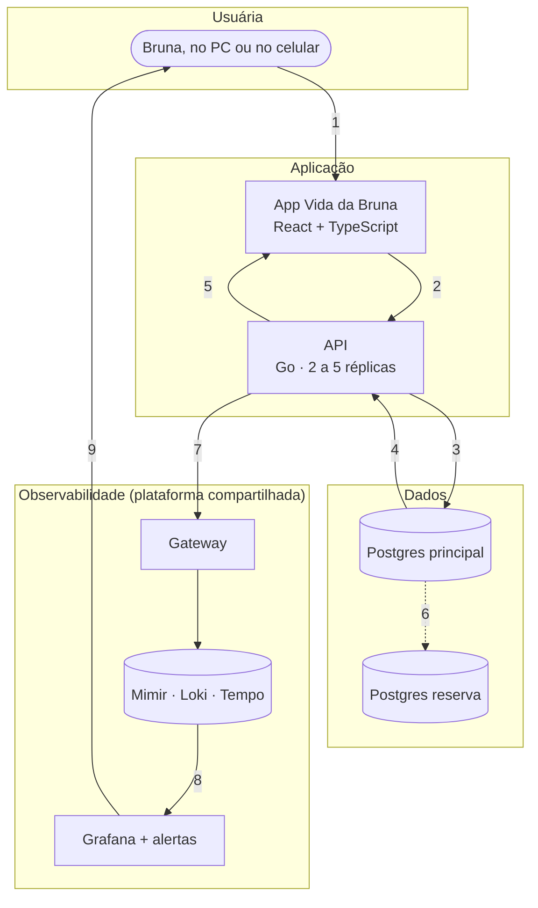
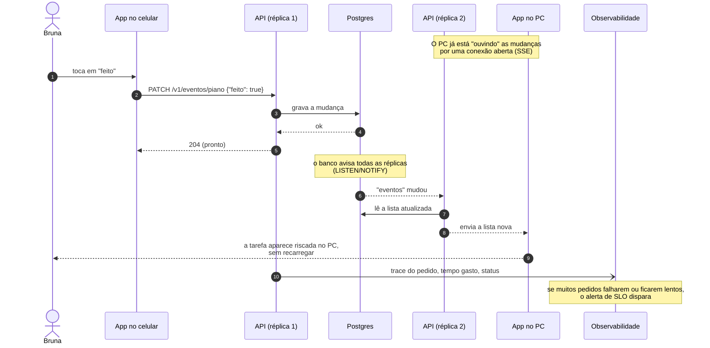
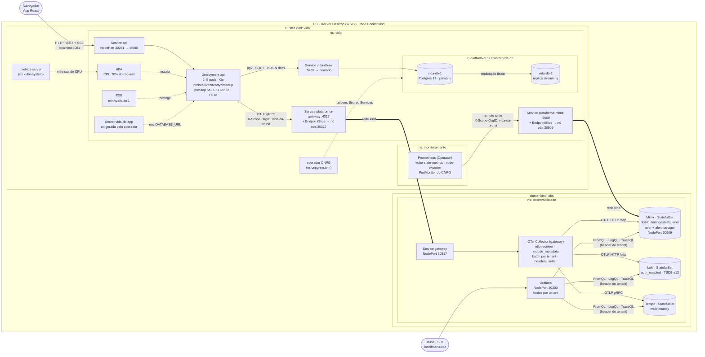

# vida-da-bruna-api

[](https://github.com/BrunaFranca/vida-da-bruna-api/actions/workflows/ci.yml)

API em Go do meu app pessoal **Vida da Bruna** (agenda, tarefas, hábitos e finanças), construída como um **laboratório de SRE**: do código ao Kubernetes, com observabilidade, SLOs, alertas de burn rate e game days documentados.

> O app em si (React + TypeScript) fica num repo privado; a observabilidade, num cluster compartilhado do repo [plataforma-observabilidade](https://github.com/BrunaFranca/plataforma-observabilidade).

## Como funciona



| Nº | De → Para | Como conversa | Por quê |
|---|---|---|---|
| 1 | Bruna → App | navegador / app instalado | ela anota tarefas, marca hábitos, lança gastos |
| 2 | App → API | HTTP (REST): `GET`, `PUT`, `PATCH`, `DELETE` | o app só desenha as telas; a API valida e grava |
| 3 | API → Postgres | SQL (pgx), dados em JSON | o banco guarda tudo de forma durável |
| 4 | Postgres → API | `LISTEN/NOTIFY` | o banco avisa na hora quando algo muda, para todas as réplicas |
| 5 | API → App | SSE: **uma** conexão aberta por aba | a tela atualiza sozinha, sem recarregar |
| 6 | Principal → Reserva | replicação do Postgres (CloudNativePG) | se o principal cair, a reserva assume sozinha |
| 7 | API → Gateway | OTLP com o tenant `vida-da-bruna` | traces, métricas e logs saem da API para a central |
| 8 | Armazenamento → Grafana | consultas PromQL, LogQL e TraceQL | painéis de saúde e metas (SLOs) |
| 9 | Grafana → Bruna | alertas de burn rate | avisa quando o app está gastando o "orçamento de erro" rápido demais |

## A jornada de um pedido

**A história:** Bruna está com o app aberto no computador e, pelo celular, marca a tarefa "Tocar piano" como feita.



**Em resumo:** o celular pede, a API grava, o banco avisa, e todas as telas abertas se atualizam, mesmo conectadas a outra cópia da API. Ao mesmo tempo, cada pedido deixa rastros na observabilidade, que mostra a saúde do app e avisa quando algo sai das metas.

## Arquitetura técnica

Visão de engenharia: clusters, namespaces, objetos do Kubernetes, protocolos e portas.



| Ligação | Protocolo / porta | Detalhe |
|---|---|---|
| Navegador → API | HTTP :8081 (NodePort 30081) | REST para escrita; **uma** conexão SSE (`/v1/stream?w=...`) por aba |
| API → Postgres | TCP :5432 via `vida-db-rw` | pool pgx; spans por query (otelpgx); `LISTEN docs` numa conexão dedicada com backoff |
| Postgres → API | `NOTIFY docs` | trigger em `docs` publica `{colecao, id}`; todas as réplicas recebem |
| Primário → réplica | replicação física (CNPG) | failover automático; `vida-db-rw` passa a apontar para o novo primário |
| API → plataforma | OTLP gRPC → `obs:30317` | `OTEL_EXPORTER_OTLP_HEADERS=X-Scope-OrgID=vida-da-bruna`; métricas a cada 10 s |
| Prometheus → Mimir | remote write → `obs:30909/api/v1/push` | métricas do cluster com `cluster="vida"` |
| Gateway → backends | OTLP (HTTP para Mimir/Loki, gRPC para Tempo) | o tenant segue no header; lotes nunca misturam tenants |
| Projeto → plataforma | API do ruler (`mimirtool rules sync`) e API do Grafana | SLOs e dashboards vivem neste repo ("você constrói, você opera") |
| Ponte entre clusters | Services sem seletor + EndpointSlice | apontam para o IP do nó `obs` na rede Docker `kind` |

**CI (GitHub Actions):** `go vet` · testes com `-race` contra Postgres real · golangci-lint · build da imagem · `promtool check rules` · validação do Collector · JSON dos dashboards · `helm lint` + kubeconform. A plataforma tem um job que sobe o cluster kind inteiro e prova o isolamento entre tenants.

## O que este projeto mostra

| Área | Onde |
|---|---|
| **API em Go** só com biblioteca padrão + pgx, desligamento gracioso, `livez` × `readyz` | `cmd/api`, `internal/httpapi` |
| **Banco:** migrations embutidas com advisory lock (réplicas não migram juntas), JSONB | `internal/migrations`, `internal/docs` |
| **Tempo real:** SSE multiplexado (navegadores limitam 6 conexões por origem) + LISTEN/NOTIFY com reconexão e backoff | `internal/aovivo`, `internal/httpapi/multi.go` |
| **OpenTelemetry:** traces (HTTP + cada query), métricas com rota, logs com `trace_id`, exemplars | `internal/telemetria` |
| **SLOs como código:** disponibilidade 99,5% e latência (95% < 300 ms), alertas de burn rate em múltiplas janelas | `observabilidade/mimir/regras` |
| **Dashboards como código:** RED e SLO (SLI, error budget, burn rate) | `observabilidade/grafana/dashboards` |
| **Kubernetes:** Helm chart com probes, HPA, PDB, `preStop`, não-root, FS somente leitura | `deploy/chart` |
| **Postgres no Kubernetes:** CloudNativePG com réplica e failover automático | `deploy/k8s/postgres.yaml` |
| **Observabilidade multi-tenant** num cluster separado ("você constrói, você opera") | `deploy/enviar-observabilidade.sh` |
| **CI:** vet, testes com `-race` contra Postgres real, golangci-lint, imagem, promtool, kubeconform | `.github/workflows/ci.yml` |
| **Game days** com resultados medidos | `docs/runbooks` |

## Resultados dos game days

| Experimento | Resultado |
|---|---|
| Banco fora do ar (Compose) | alerta **critical** de burn rate disparou com 100% de 5xx; resolveu sozinho ~6 min após a volta |
| Carga de ~255 req/s (Kubernetes) | HPA escalou de **2 para 5 réplicas** |
| Matar um pod da API | sem impacto visível |
| Derrubar o primário do Postgres | **failover automático** para a réplica |
| **Total no Kubernetes** | **76.392 requisições, 0,02% de erro, p95 ≈ 5 ms** |

## Como rodar

**Modo rápido (Docker Compose):** API, Postgres e o stack LGTM completo numa máquina só.
```bash
docker compose up --build -d                  # API :8080 · Grafana :3000
docker compose --profile carga run --rm k6    # tráfego de teste
```

**Modo Kubernetes (dois clusters kind):**
```bash
bash ../plataforma-observabilidade/scripts/subir.sh   # cluster "obs" (Grafana :3300)
bash deploy/subir.sh                                  # cluster "vida" (API :8081)
bash deploy/enviar-observabilidade.sh                 # SLOs e dashboards → plataforma
```

**Testes:** `go test ./...` (os de integração usam `TEST_DATABASE_URL`, ver `AGENTS.md`).

## Rotas

| Rota | Faz |
|---|---|
| `GET /livez` · `GET /readyz` | vivo? · pronto (banco ok)? |
| `GET/POST /v1/{col}` | lista · cria (id gerado) |
| `GET/PUT/PATCH/DELETE /v1/{col}/{id}` | lê · substitui · mescla · apaga (idempotente) |
| `GET /v1/stream?w=<col>&w=<col>/<id>` | tempo real (SSE), vários itens numa conexão |

## Decisões e documentação
- [ADR 0001: plano e etapas do lab](docs/adr/0001-lab-sre-api-go.md)
- [Runbook: banco fora do ar](docs/runbooks/banco-fora.md) · [Game day no Kubernetes](docs/runbooks/gameday-kubernetes.md)
- Próximo passo: levar para a nuvem (Cloud Run + Postgres gerenciado + Terraform), para o app usar a API no PC e no celular.
