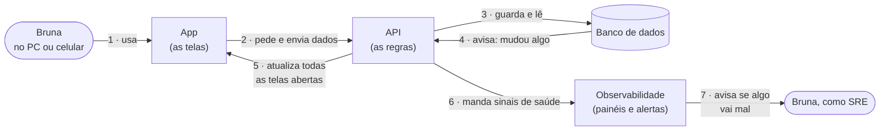
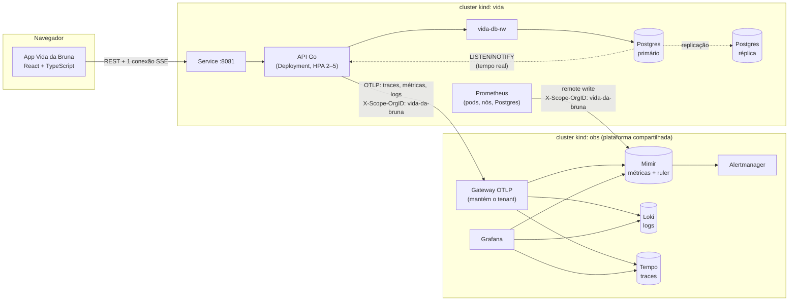
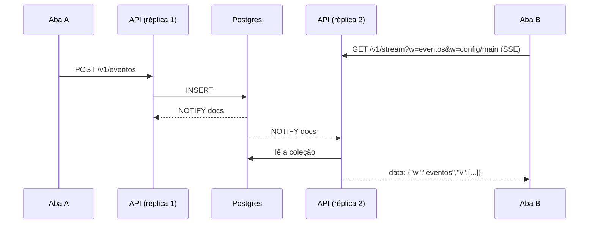

# vida-da-bruna-api

[](https://github.com/BrunaFranca/vida-da-bruna-api/actions/workflows/ci.yml)

API em Go do meu app pessoal **Vida da Bruna** (agenda, tarefas, hábitos e finanças), construída como um **laboratório de SRE**: do código ao Kubernetes, com observabilidade, SLOs, alertas de burn rate e game days documentados.

> O app em si (React + TypeScript) fica num repo privado; a observabilidade, num cluster compartilhado do repo [plataforma-observabilidade](https://github.com/BrunaFranca/plataforma-observabilidade).

## Como funciona (visão simples)



1. **Bruna usa o app** no computador ou no celular: anota uma tarefa, marca um hábito, lança um gasto.
2. **O app conversa com a API.** O app só desenha as telas; quem guarda e entrega os dados é a API, um programa que fica num servidor.
3. **A API guarda tudo no banco de dados** (Postgres). O banco tem uma cópia reserva sempre atualizada: se o principal cair, a cópia assume sozinha.
4. **O banco avisa a API quando algo muda.**
5. **A API atualiza na hora todas as telas abertas.** Se Bruna marca uma tarefa no celular, o computador mostra a mudança sem precisar recarregar.
6. **Enquanto trabalha, a API manda "sinais de saúde"**: quanto tempo cada pedido levou, se deu erro, o caminho de cada pedido.
7. **A observabilidade transforma esses sinais em painéis e alertas.** Se o app começar a falhar ou ficar lento demais (abaixo das metas combinadas), um alerta avisa antes de alguém reclamar.

**Onde tudo roda:** a API e o banco rodam num "cluster" Kubernetes (um conjunto de máquinas que mantém tudo no ar e cria mais cópias da API quando o uso aumenta). A observabilidade roda em outro cluster, compartilhado, que pode atender outros projetos no futuro.

## Arquitetura (visão técnica)



**Tempo real:** uma escrita em qualquer réplica chega a todos os navegadores conectados em qualquer réplica.



## O que este projeto mostra

| Área | Onde |
|---|---|
| **API em Go** só com biblioteca padrão + pgx, desligamento gracioso, `livez` × `readyz` | `cmd/api`, `internal/httpapi` |
| **Banco:** migrations embutidas com advisory lock (réplicas não migram juntas), JSONB | `internal/migrations`, `internal/docs` |
| **Tempo real:** SSE multiplexado (navegadores limitam 6 conexões por origem) + LISTEN/NOTIFY com reconexão e backoff | `internal/aovivo`, `internal/httpapi/multi.go` |
| **OpenTelemetry:** traces (HTTP + cada query), métricas com rota, logs com `trace_id`, exemplars | `internal/telemetria` |
| **SLOs como código:** disponibilidade 99,5% e latência (95% < 300 ms), alertas de burn rate em múltiplas janelas | `observabilidade/mimir/regras` |
| **Dashboards como código:** RED e SLO (SLI, error budget, burn rate) | `observabilidade/grafana/dashboards` |
| **Kubernetes:** Helm chart com probes, HPA, PDB, `preStop`, não-root, FS somente leitura | `deploy/chart` |
| **Postgres no Kubernetes:** CloudNativePG com réplica e failover automático | `deploy/k8s/postgres.yaml` |
| **Observabilidade multi-tenant** num cluster separado ("você constrói, você opera") | `deploy/enviar-observabilidade.sh` |
| **CI:** vet, testes com `-race` contra Postgres real, golangci-lint, imagem, promtool, kubeconform | `.github/workflows/ci.yml` |
| **Game days** com resultados medidos | `docs/runbooks` |

## Resultados dos game days

| Experimento | Resultado |
|---|---|
| Banco fora do ar (Compose) | alerta **critical** de burn rate disparou com 100% de 5xx; resolveu sozinho ~6 min após a volta |
| Carga de ~255 req/s (Kubernetes) | HPA escalou de **2 para 5 réplicas** |
| Matar um pod da API | sem impacto visível |
| Derrubar o primário do Postgres | **failover automático** para a réplica |
| **Total no Kubernetes** | **76.392 requisições, 0,02% de erro, p95 ≈ 5 ms** |

## Como rodar

**Modo rápido (Docker Compose):** API, Postgres e o stack LGTM completo numa máquina só.
```bash
docker compose up --build -d                  # API :8080 · Grafana :3000
docker compose --profile carga run --rm k6    # tráfego de teste
```

**Modo Kubernetes (dois clusters kind):**
```bash
bash ../plataforma-observabilidade/scripts/subir.sh   # cluster "obs" (Grafana :3300)
bash deploy/subir.sh                                  # cluster "vida" (API :8081)
bash deploy/enviar-observabilidade.sh                 # SLOs e dashboards → plataforma
```

**Testes:** `go test ./...` (os de integração usam `TEST_DATABASE_URL`, ver `AGENTS.md`).

## Rotas

| Rota | Faz |
|---|---|
| `GET /livez` · `GET /readyz` | vivo? · pronto (banco ok)? |
| `GET/POST /v1/{col}` | lista · cria (id gerado) |
| `GET/PUT/PATCH/DELETE /v1/{col}/{id}` | lê · substitui · mescla · apaga (idempotente) |
| `GET /v1/stream?w=<col>&w=<col>/<id>` | tempo real (SSE), vários itens numa conexão |

## Decisões e documentação
- [ADR 0001: plano e etapas do lab](docs/adr/0001-lab-sre-api-go.md)
- [Runbook: banco fora do ar](docs/runbooks/banco-fora.md) · [Game day no Kubernetes](docs/runbooks/gameday-kubernetes.md)
- Próximo passo: levar para a nuvem (Cloud Run + Postgres gerenciado + Terraform), para o app usar a API no PC e no celular.
